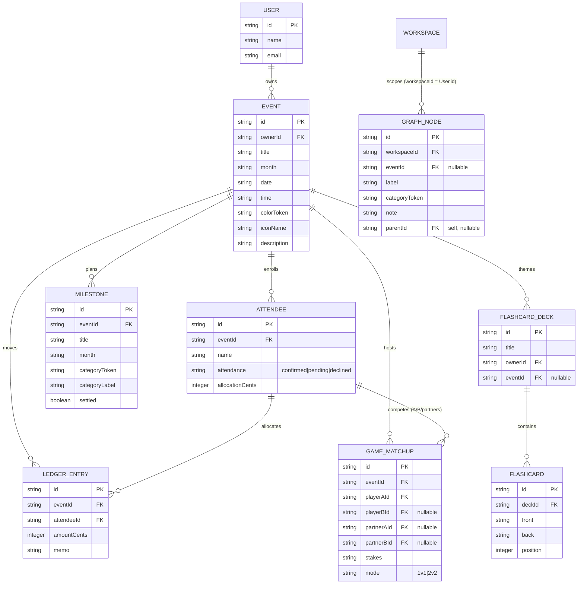

# SCHEMA V3 — The Normalized Data Layer & The FastAPI Contract (3.0.0)

> The **contract source of truth** is `shared/schema.ts` — zero-dependency
> TypeScript DTOs + runtime guards. This document mirrors it 1:1 with the
> ERD, the SQLite + PostgreSQL DDL, the FastAPI Pydantic v2 models, and
> the REST contract table. Change one, change both (the release gates
> needle both files).

## Why this schema exists

The playground is an honest fake: `SEED_MEMBERS` drives the live bento,
`usePersistentState("sig.workspace.v3.graph"/"sig.workspace.v3.timeline")` persists the
workspace, and the snapshot export/import moves `{ version: "sig.workspace.v3",
graph, timeline }` through `signature-workspace.json`. v3.0.0 writes the
**normalized** layer a real backend (FastAPI + SQLite/PostgreSQL) will
serve, with every field traced to the frontend usage it earns. Nothing
speculative ships: if a field has no caller, it has no column.

## The Money-in-Cents rule (non-negotiable)

All money is **integer cents** (`allocationCents: 12000` = $120.00).

- **Floats drift.** `0.1 + 0.2 !== 0.3`; a shared-pot ledger that sums
  float dollars will eventually disagree with its own rows by a cent —
  an un-reconcilable wrong total.
- **Integers are exact** in JS (`Number`), SQLite (`INTEGER`), and
  PostgreSQL (`BIGINT`). Sums, splits, and percentage buckets stay in
  the integer domain end-to-end.
- **Formatting happens once** at the display boundary
  (`amountCents / 100` → `Intl.NumberFormat`). The wire, the DB, and
  the math never see a decimal point.
- The demo's in-memory `Member.allocation` (whole dollars,
  `playground/App.tsx`) stays for ergonomics; the **persisted/wire**
  format is cents.

## Normalized ERD



ASCII form (the same graph):

```
User 1──*Event 1──*Attendee 1──*LedgerEntry
              ││││
              │││└──*GameMatchup   (playerAId/playerBId/partnerAId/partnerBId → Attendee)
              ││└──*Milestone
              │└──*FlashcardDeck 1──*Flashcard
              └──*GraphNode (workspaceId → User, eventId nullable, parentId → self)
```

`GRAPH_NODE.parentId` is a **self-referencing FK** — the package's
`GraphNode.parentId?: string` (react/graph.d.ts), where `undefined`
renders a root. Extra (non-tree) links (the 3.0.0 `onLinkNodes`
model extension) are *derived* in the client from `parentId` + the
extra-links array in the persisted workspace state; the server-side
normalization keeps one storage form: `parentId` edges.

## SQLite DDL

```sql
CREATE TABLE users (
  id         TEXT PRIMARY KEY,                -- ULID/uuid7 (string, JS-native)
  name       TEXT NOT NULL,
  email      TEXT NOT NULL UNIQUE,
  created_at TEXT NOT NULL                    -- ISO 8601 instant
);

CREATE TABLE events (
  id          TEXT PRIMARY KEY,
  owner_id    TEXT NOT NULL REFERENCES users(id) ON DELETE CASCADE,
  title       TEXT NOT NULL,
  month       TEXT NOT NULL,                  -- the UI bucket: "December 2026"
  date        TEXT NOT NULL,                  -- ISO date (sortable truth)
  time        TEXT,                           -- "18:00"
  color_token TEXT NOT NULL,                  -- a --sig-* token
  icon_name   TEXT,                           -- a lucide key
  description TEXT,
  created_at  TEXT NOT NULL
);
CREATE INDEX idx_events_owner  ON events(owner_id);
CREATE INDEX idx_events_date   ON events(date);

CREATE TABLE attendees (
  id                 TEXT PRIMARY KEY,
  event_id           TEXT NOT NULL REFERENCES events(id) ON DELETE CASCADE,
  name               TEXT NOT NULL,
  attendance         TEXT NOT NULL CHECK (attendance IN ('confirmed','pending','declined')),
  allocation_cents INTEGER NOT NULL DEFAULT 0 CHECK (allocation_cents >= 0),
  created_at         TEXT NOT NULL
);
CREATE INDEX idx_attendees_event ON attendees(event_id);

CREATE TABLE ledger_entries (
  id            TEXT PRIMARY KEY,
  event_id      TEXT NOT NULL REFERENCES events(id) ON DELETE CASCADE,
  attendee_id   TEXT NOT NULL REFERENCES attendees(id) ON DELETE CASCADE,
  amount_cents  INTEGER NOT NULL CHECK (amount_cents != 0),
  memo          TEXT,
  created_at    TEXT NOT NULL
);
CREATE INDEX idx_ledger_event ON ledger_entries(event_id);
CREATE INDEX idx_ledger_attendee ON ledger_entries(attendee_id);

CREATE TABLE milestones (
  id             TEXT PRIMARY KEY,
  event_id       TEXT NOT NULL REFERENCES events(id) ON DELETE CASCADE,
  title          TEXT NOT NULL,
  month          TEXT NOT NULL,
  category_token TEXT NOT NULL,               -- a --sig-* token
  category_label TEXT,
  settled        INTEGER NOT NULL DEFAULT 0,  -- 0/1 (SQLite boolean)
  created_at     TEXT NOT NULL
);
CREATE INDEX idx_milestones_event ON milestones(event_id);

CREATE TABLE graph_nodes (
  id            TEXT PRIMARY KEY,
  workspace_id  TEXT NOT NULL REFERENCES users(id) ON DELETE CASCADE,
  event_id      TEXT REFERENCES events(id) ON DELETE SET NULL,
  label         TEXT NOT NULL,
  category_token TEXT NOT NULL,               -- a --sig-* token
  note          TEXT,
  parent_id     TEXT REFERENCES graph_nodes(id) ON DELETE SET NULL, -- self; NULL = root
  created_at    TEXT NOT NULL
);
CREATE INDEX idx_graph_nodes_workspace ON graph_nodes(workspace_id);
CREATE INDEX idx_graph_nodes_parent    ON graph_nodes(parent_id);

CREATE TABLE flashcard_decks (
  id         TEXT PRIMARY KEY,
  title      TEXT NOT NULL,
  owner_id   TEXT NOT NULL REFERENCES users(id) ON DELETE CASCADE,
  event_id   TEXT REFERENCES events(id) ON DELETE SET NULL,
  created_at TEXT NOT NULL
);
CREATE INDEX idx_decks_owner ON flashcard_decks(owner_id);

CREATE TABLE flashcards (
  id       TEXT PRIMARY KEY,
  deck_id  TEXT NOT NULL REFERENCES flashcard_decks(id) ON DELETE CASCADE,
  front    TEXT NOT NULL,                     -- FlipCardProps.front (react/cards.d.ts)
  back     TEXT NOT NULL,                     -- FlipCardProps.back
  position INTEGER NOT NULL CHECK (position >= 0)
);
CREATE INDEX idx_flashcards_deck ON flashcards(deck_id);

CREATE TABLE game_matchups (
  id           TEXT PRIMARY KEY,
  event_id     TEXT NOT NULL REFERENCES events(id) ON DELETE CASCADE,
  player_a_id  TEXT NOT NULL REFERENCES attendees(id),
  player_b_id  TEXT REFERENCES attendees(id),
  partner_a_id TEXT REFERENCES attendees(id),
  partner_b_id TEXT REFERENCES attendees(id),
  stakes       TEXT,                          -- the mono footer line
  mode         TEXT NOT NULL CHECK (mode IN ('1v1','2v2')),
  created_at   TEXT NOT NULL,
  CHECK (mode != '2v2' OR (partner_a_id IS NOT NULL AND partner_b_id IS NOT NULL)),
  CHECK (mode != '1v1' OR (player_b_id IS NOT NULL))
);
CREATE INDEX idx_matchups_event ON game_matchups(event_id);
```

## PostgreSQL DDL (the production twin)

Same tables/columns; the deltas are the typed twin:

```sql
CREATE TABLE users (
  id         UUID PRIMARY KEY,
  name       TEXT NOT NULL,
  email      TEXT NOT NULL UNIQUE,
  created_at TIMESTAMPTZ NOT NULL DEFAULT now()
);

CREATE TABLE events (
  id          UUID PRIMARY KEY,
  owner_id    UUID NOT NULL REFERENCES users(id) ON DELETE CASCADE,
  title       TEXT NOT NULL,
  month       TEXT NOT NULL,
  date        DATE NOT NULL,
  time        TEXT,
  color_token TEXT NOT NULL,
  icon_name   TEXT,
  description TEXT,
  created_at  TIMESTAMPTZ NOT NULL DEFAULT now()
);
CREATE INDEX idx_events_owner ON events(owner_id);
CREATE INDEX idx_events_date  ON events(date);

CREATE TABLE attendees (
  id                 UUID PRIMARY KEY,
  event_id           UUID NOT NULL REFERENCES events(id) ON DELETE CASCADE,
  name               TEXT NOT NULL,
  attendance         TEXT NOT NULL CHECK (attendance IN ('confirmed','pending','declined')),
  allocation_cents BIGINT NOT NULL DEFAULT 0 CHECK (allocation_cents >= 0),
  created_at         TIMESTAMPTZ NOT NULL DEFAULT now()
);
CREATE INDEX idx_attendees_event ON attendees(event_id);

CREATE TABLE ledger_entries (
  id           UUID PRIMARY KEY,
  event_id     UUID NOT NULL REFERENCES events(id) ON DELETE CASCADE,
  attendee_id  UUID NOT NULL REFERENCES attendees(id) ON DELETE CASCADE,
  amount_cents BIGINT NOT NULL CHECK (amount_cents != 0),
  memo         TEXT,
  created_at   TIMESTAMPTZ NOT NULL DEFAULT now()
);
CREATE INDEX idx_ledger_event ON ledger_entries(event_id);
CREATE INDEX idx_ledger_attendee ON ledger_entries(attendee_id);

CREATE TABLE milestones (
  id             UUID PRIMARY KEY,
  event_id       UUID NOT NULL REFERENCES events(id) ON DELETE CASCADE,
  title          TEXT NOT NULL,
  month          TEXT NOT NULL,
  category_token TEXT NOT NULL,
  category_label TEXT,
  settled        BOOLEAN NOT NULL DEFAULT FALSE,
  created_at     TIMESTAMPTZ NOT NULL DEFAULT now()
);
CREATE INDEX idx_milestones_event ON milestones(event_id);

CREATE TABLE graph_nodes (
  id             UUID PRIMARY KEY,
  workspace_id   UUID NOT NULL REFERENCES users(id) ON DELETE CASCADE,
  event_id       UUID REFERENCES events(id) ON DELETE SET NULL,
  label          TEXT NOT NULL,
  category_token TEXT NOT NULL,
  note           TEXT,
  parent_id      UUID REFERENCES graph_nodes(id) ON DELETE SET NULL,
  created_at     TIMESTAMPTZ NOT NULL DEFAULT now()
);
CREATE INDEX idx_graph_nodes_workspace ON graph_nodes(workspace_id);
CREATE INDEX idx_graph_nodes_parent    ON graph_nodes(parent_id);

CREATE TABLE flashcard_decks (
  id         UUID PRIMARY KEY,
  title      TEXT NOT NULL,
  owner_id   UUID NOT NULL REFERENCES users(id) ON DELETE CASCADE,
  event_id   UUID REFERENCES events(id) ON DELETE SET NULL,
  created_at TIMESTAMPTZ NOT NULL DEFAULT now()
);
CREATE INDEX idx_decks_owner ON flashcard_decks(owner_id);

CREATE TABLE flashcards (
  id       UUID PRIMARY KEY,
  deck_id  UUID NOT NULL REFERENCES flashcard_decks(id) ON DELETE CASCADE,
  front    TEXT NOT NULL,
  back     TEXT NOT NULL,
  position INTEGER NOT NULL CHECK (position >= 0)
);
CREATE INDEX idx_flashcards_deck ON flashcards(deck_id);

CREATE TABLE game_matchups (
  id           UUID PRIMARY KEY,
  event_id     UUID NOT NULL REFERENCES events(id) ON DELETE CASCADE,
  player_a_id  UUID NOT NULL REFERENCES attendees(id),
  player_b_id  UUID REFERENCES attendees(id),
  partner_a_id UUID REFERENCES attendees(id),
  partner_b_id UUID REFERENCES attendees(id),
  stakes       TEXT,
  mode         TEXT NOT NULL CHECK (mode IN ('1v1','2v2')),
  created_at   TIMESTAMPTZ NOT NULL DEFAULT now(),
  CHECK (mode != '2v2' OR (partner_a_id IS NOT NULL AND partner_b_id IS NOT NULL)),
  CHECK (mode != '1v1' OR (player_b_id IS NOT NULL))
);
CREATE INDEX idx_matchups_event ON game_matchups(event_id);
```

## FastAPI Pydantic v2 models (mirror of shared/schema.ts, 1:1)

```python
"""shared/schema.py — the FastAPI twin of shared/schema.ts (1:1)."""
from __future__ import annotations
from datetime import datetime
from typing import Annotated, Generic, Literal, TypeVar
from pydantic import BaseModel, ConfigDict, EmailStr, Field

T = TypeVar("T")

# Money is integer cents — the Money-in-Cents rule (see SCHEMA_V3.md).
Cents = Annotated[int, Field(strict=True, ge=0)]
LedgerCents = Annotated[int, Field(strict=True)]  # may be negative (refund)

class User(BaseModel):
    model_config = ConfigDict(extra="forbid")
    id: str
    name: str
    email: EmailStr
    created_at: datetime

class Event(BaseModel):
    model_config = ConfigDict(extra="forbid")
    id: str
    owner_id: str
    title: str
    month: str                      # the UI bucket: "December 2026"
    date: str                       # ISO date
    time: str | None = None
    color_token: str                # a --sig-* token
    icon_name: str | None = None
    description: str | None = None
    created_at: datetime

AttendanceStatus = Literal["confirmed", "pending", "declined"]

class Attendee(BaseModel):
    model_config = ConfigDict(extra="forbid")
    id: str
    event_id: str
    name: str
    attendance: AttendanceStatus
    allocation_cents: Cents
    created_at: datetime

class LedgerEntry(BaseModel):
    model_config = ConfigDict(extra="forbid")
    id: str
    event_id: str
    attendee_id: str
    amount_cents: LedgerCents       # integer cents; != 0
    memo: str | None = None
    created_at: datetime

class Milestone(BaseModel):
    model_config = ConfigDict(extra="forbid")
    id: str
    event_id: str
    title: str
    month: str
    category_token: str             # a --sig-* token
    category_label: str | None = None
    settled: bool = False
    created_at: datetime

class GraphNodeRecord(BaseModel):
    model_config = ConfigDict(extra="forbid")
    id: str
    workspace_id: str
    event_id: str | None = None
    label: str
    category_token: str             # a --sig-* token
    note: str | None = None
    parent_id: str | None = None    # NULL = root
    created_at: datetime

class FlashcardDeck(BaseModel):
    model_config = ConfigDict(extra="forbid")
    id: str
    title: str
    owner_id: str
    event_id: str | None = None
    created_at: datetime

class Flashcard(BaseModel):
    model_config = ConfigDict(extra="forbid")
    id: str
    deck_id: str
    front: str                      # FlipCardProps.front (react/cards.d.ts)
    back: str                       # FlipCardProps.back
    position: int = Field(ge=0)

class GameMatchup(BaseModel):
    model_config = ConfigDict(extra="forbid")
    id: str
    event_id: str
    player_a_id: str
    player_b_id: str | None = None
    partner_a_id: str | None = None
    partner_b_id: str | None = None
    stakes: str | None = None
    mode: Literal["1v1", "2v2"]
    created_at: datetime

class ApiError(BaseModel):
    code: str                       # "not_found" | "validation_error" | "conflict"
    message: str
    details: dict[str, list[str]] | None = None

class Paginated(BaseModel, Generic[T]):
    data: list[T]
    total: int
    limit: int
    offset: int
```

## The REST API contract

Envelope rules: success returns the DTO (or `Paginated<T>` for lists);
errors return `ApiError` with the matching status. Money fields are
always integer cents. Pagination is `?limit=&offset=` (limit ≤ 100).

| Method | Path | Request DTO | Success | Error | Notes |
|--------|------|-------------|---------|-------|-------|
| GET | `/events` | — | `Paginated[Event]` | `ApiError` | `?limit/offset`, `?owner_id` |
| POST | `/events` | `Event` (minus id/createdAt) | `Event` | `201` / `422 ApiError` | validates `color_token` is a `--sig-*` name |
| GET | `/events/{id}` | — | `Event` | `200` / `404 ApiError` | |
| DELETE | `/events/{id}` | — | `204` | `404 ApiError` | cascades attendees/ledger/milestones/matchups |
| GET | `/events/{id}/attendees` | — | `Paginated[Attendee]` | `404 ApiError` | the live ledger's source |
| POST | `/events/{id}/attendees` | `Attendee` (minus id/createdAt) | `Attendee` | `201` / `422 ApiError` | `attendance` enum enforced by CHECK + Literal |
| PATCH | `/attendees/{id}` | `{ attendance?, allocation_cents? }` | `Attendee` | `200` / `404 ApiError` | the attendance radio card submit |
| GET | `/attendees/{id}/ledger-entries` | — | `Paginated[LedgerEntry]` | `404 ApiError` | |
| POST | `/attendees/{id}/ledger-entries` | `LedgerEntry` (minus id/createdAt) | `LedgerEntry` | `201` / `422 ApiError` | `amount_cents != 0` |
| GET | `/events/{id}/milestones` | — | `Paginated[Milestone]` | `404 ApiError` | grouped by `month` client-side |
| POST | `/events/{id}/milestones` | `Milestone` (minus id/createdAt) | `Milestone` | `201` / `422 ApiError` | the TimelineManager composer |
| PATCH | `/milestones/{id}` | `{ settled?, title?, category_token? }` | `Milestone` | `200` / `404 ApiError` | the aria-pressed settle toggle |
| DELETE | `/milestones/{id}` | — | `204` | `404 ApiError` | the Trash button |
| GET | `/decks` | — | `Paginated[FlashcardDeck]` | `ApiError` | `?owner_id` |
| POST | `/decks` | `FlashcardDeck` (minus id/createdAt) | `FlashcardDeck` | `201` / `422 ApiError` | |
| GET | `/decks/{id}/flashcards` | — | `Paginated[Flashcard]` | `404 ApiError` | ordered by `position` |
| POST | `/decks/{id}/flashcards` | `Flashcard` (minus id/createdAt) | `Flashcard` | `201` / `422 ApiError` | the FlipCard pair |
| GET | `/events/{id}/matchups` | — | `Paginated[GameMatchup]` | `404 ApiError` | |
| POST | `/events/{id}/matchups` | `GameMatchup` (minus id/createdAt) | `GameMatchup` | `201` / `422 ApiError` | mode CHECK: 2v2 ⇒ partners present |
| GET | `/graph?workspace_id=` | — | `Paginated[GraphNodeRecord]` | `ApiError` | the sig.workspace.v3.graph normalization |
| POST | `/graph` | `GraphNodeRecord` (minus id/createdAt) | `GraphNodeRecord` | `201` / `422 ApiError` | `parent_id: null` = root |

Error status codes: `404 not_found` (missing row), `422
validation_error` (Pydantic/CHECK), `409 conflict` (duplicate email /
position collision), everything else falls through the generic
`ApiError` handler.

## Field → frontend usage trace

| Field | Frontend caller |
|-------|-----------------|
| `Event.month` / `Event.time` / `Event.title` / `Event.description` | `MockEvent` fields → `TimelineEvent` (`playground/App.tsx` mockEvents, mapped at the ONE mapping layer; rendered by `react/timeline.tsx` + the EventModal About row) |
| `Event.colorToken` / `Event.iconName` | `MockEvent.colorToken` → `TimelineEvent.category` (SigBadge chip), `MockEvent.iconName` → `TimelineEvent.icon` (lucide key, gate-probed) |
| `Attendee.name` / `Attendee.attendance` / `Attendee.allocation` | `playground/App.tsx` `Member` + `SEED_MEMBERS` + `derived.ledgerRows` (the live bento's one reactive array) |
| `LedgerEntry.amountCents` | the ledger's `Allocation` column (`numeric: true, align: "right"`, `playground/App.tsx` BENTO_LEDGER_COLUMNS) — persisted in cents per the Money-in-Cents rule |
| `Milestone.title/month/categoryToken/categoryLabel/settled` | `TimelineItem extends TimelineEvent` (`react/timeline-manager.d.ts`) + `SEED_TIMELINE` (`playground/App.tsx`, persisted as `sig.workspace.v3.timeline`) |
| `GraphNodeRecord.label/categoryToken/note/parentId` | `GraphNode` (`react/graph.d.ts`), persisted as `sig.workspace.v3.graph` (`playground/App.tsx` `usePersistentState`) — `parentId: undefined` renders a root |
| `Flashcard.front/back` | `FlipCardProps.front/back` (`react/cards.d.ts`) — `playground/App.tsx` renders `<FlipCard front="Dare: ship it on Friday" back="…or write the postmortem" />` |
| `GameMatchup.playerAId/playerBId/stakes/mode` | `MatchupCardProps` (`react/cards.d.ts`: `left`/`right` names, `stakes` mono footer) — the bento's A-vs-B card; `mode` extends it to the 2-vs-2 case |
| `ApiError` / `Paginated<T>` | the snapshot import shape gate (`playground/App.tsx` `isGraphNodeish`/`isTimelineItemish`) graduates into `shared/schema.ts`'s guards |

## Relationship to the v2.7.0 storage keys

`sig.workspace.v3.graph` / `sig.workspace.v3.timeline` keep working unchanged (the
localStorage mirror). When the backend lands, the shapes graduate
1:1: `GraphNode` → `GraphNodeRecord`, `TimelineItem` → `Milestone`
with the key bump `sig.v30.*` per the storage-key contract documented
in `playground/persistence.ts` (never store new shapes under an old
prefix).
